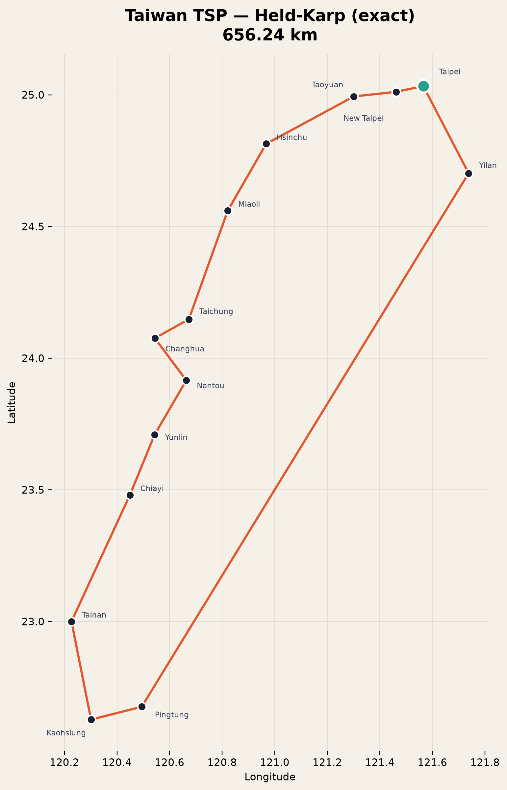
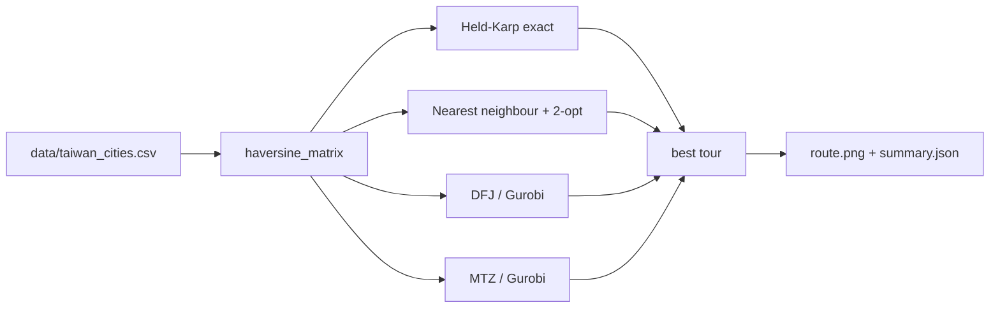

<div align="center">

# 🇹🇼 Taiwan TSP — two formulations, one optimal route

**The travelling salesman problem on 14 Taiwanese cities, solved with a Dantzig–Fulkerson–Johnson
model, a Miller–Tucker–Zemlin model, an exact Held–Karp DP and a 2-opt heuristic.**

[](https://www.python.org/)
[](https://www.gurobi.com/)
[](https://numpy.org/)
[](https://jupyter.org/)
[](#-testing)
[](LICENSE)

[**Open the project**](https://github.com/BennyLinntu/TSP_Taiwan) ·
[**Report a bug**](https://github.com/BennyLinntu/TSP_Taiwan/issues)

</div>

---

## 🖼️ Preview

<div align="center">
  
  <p><em>Held–Karp exact tour · 656.24 km · 14 cities</em></p>
</div>

---

## 📌 The problem

> Given a list of cities and the distances between them, what is the shortest possible
> route that visits every city exactly once and returns to the starting city?

TSP is NP-hard. This repository studies the same 14-city instance through four lenses:

| Method | Type | Guarantee | Needs Gurobi? |
|---|---|---|---|
| **DFJ** | MILP, exponential subtour cuts | Optimal | Yes |
| **MTZ** | MILP, polynomial order variables | Optimal | Yes |
| **Held–Karp** | Bitmask dynamic programming | Optimal | No |
| **Nearest neighbour + 2-opt** | Heuristic | Good, not proven | No |

---

## 🧮 Formulations

### Method 1 — DFJ

One binary variable per directed arc, degree constraints, and a subtour-elimination
constraint for **every** proper subset of non-depot cities:

$$
\begin{aligned}
\min\quad & \sum_i\sum_{j\ne i} d_{ij}x_{ij} \\
\text{s.t.}\quad
& \sum_{j\ne i}x_{ij}=1,\qquad \sum_{j\ne i}x_{ji}=1 && \forall i \\
& \sum_{i\in S}\sum_{j\in S, j\ne i}x_{ij}\le |S|-1
&& \forall S\subset V\setminus\{0\},\ 2\le|S|\le n-1 \\
& x_{ij}\in\{0,1\}
\end{aligned}
$$

For 14 cities this adds **8,178 subset cuts**. The LP relaxation is tight, so Gurobi usually
closes the instance quickly.

### Method 2 — MTZ

The same arcs, but order variables replace the exponential cut family:

$$
u_i-u_j+n x_{ij}\le n-1,\qquad u_0=1,\qquad 1\le u_i\le n-1
$$

Only ~$n^2+n$ variables are needed, but the relaxation is weaker. Both models should return
the same objective on a symmetric instance.

---

## 📊 Result

```
Held-Karp (exact)        656.24 km    0.15 s
Nearest neighbour+2-opt  656.24 km    <0.01 s
```

**Optimal route**

```text
Taipei → Yilan → Pingtung → Kaohsiung → Tainan → Chiayi → Yunlin
      → Nantou → Changhua → Taichung → Miaoli → Hsinchu → Taoyuan
      → New Taipei → Taipei
```

The heuristic happens to find an equal-cost tour on this instance (a different rotation of
the same cycle), which is a nice reminder that "heuristic = optimal" is an observation, not
a guarantee.

> The tour uses **great-circle distances**, not road distances. A 656 km loop is a
> geometric TSP result, not a driving itinerary.

---

## 🚀 Quick start

```bash
git clone --branch TSP_Taiwan https://github.com/BennyLinntu/TSP_Taiwan.git
cd TSP_Taiwan

python -m venv .venv
# Windows
.\.venv\Scripts\Activate.ps1
# macOS / Linux
# source .venv/bin/activate

pip install -r requirements.txt
python tsp_solver.py
```

Generated files:

| File | Purpose |
|---|---|
| `results/route.png` | Route map of the best solution |
| `results/summary.json` | Costs, runtimes and tour names |

### With Gurobi

```bash
pip install -r requirements-gurobi.txt
python tsp_solver.py --gurobi
python tsp_solver.py --gurobi --verbose-gurobi --time-limit 60
```

If `gurobipy` or a licence is unavailable, the solver catches the error and still produces
the exact Held–Karp result.

### Notebooks

| Notebook | Contents |
|---|---|
| [`Method_1.ipynb`](Method_1.ipynb) | DFJ derivation, full model and route plot |
| [`Method_2.ipynb`](Method_2.ipynb) | MTZ derivation, compact model and comparison |

Both notebooks fall back to Held–Karp when Gurobi is not installed, so they remain runnable
for every reader.

---

## 🧠 Code map



| Function | Role |
|---|---|
| `load_cities()` | Read and validate the CSV |
| `haversine_matrix()` | Great-circle distances in km |
| `held_karp()` | Exact bitmask DP |
| `nearest_neighbor()` | Constructive heuristic |
| `two_opt()` | Local search improvement |
| `solve_dfj()` | Gurobi DFJ model |
| `solve_mtz()` | Gurobi MTZ model |
| `plot_route()` | Matplotlib route map |
| `save_results()` | JSON summary |

---

## 🧪 Testing

```bash
python -m unittest discover -s tests -v
```

7 tests cover:

- ✅ dataset shape, coordinates and unique names
- ✅ symmetric distance matrix with zero diagonal
- ✅ Held–Karp on a known 4-city square (cost = 4)
- ✅ complete exact tour and cost consistency
- ✅ heuristic validity and non-better-than-exact property
- ✅ route-name conversion
- ✅ PNG + JSON export

---

## 📁 Project structure

```text
TSP_Taiwan/
├──  tsp_solver.py               # data, distances, solvers, CLI, plotting
├──  data/
│  ├──  taiwan_cities.csv       # 14 city-centre coordinates
│  └──  README.md               # dataset notes
├──  tests/test_tsp.py           # 7 offline tests
├──  Method_1.ipynb              # DFJ tutorial
├──  Method_2.ipynb              # MTZ tutorial
├──  results/
│  ├──  route.png               # generated route map
│  └──  summary.json            # generated comparison
├──  requirements.txt
├──  requirements-gurobi.txt
└──  .github/workflows/tests.yml
```

---

## 🧹 What changed from the original notebooks

The original notebooks had three reproducibility problems:

1. 🗂️They referenced a **missing Excel file** with a mojibake filename
   (a mojibake-named `.xlsx` file), so they could not run.
2. 🔤 The column names were corrupted during an encoding conversion.
3. 🧩 Method 2 assumed 43 cities while Method 1 used 14, making the two hard to compare.

This revision adds a transparent 14-city CSV, computes distances with haversine, rebuilds
both formulations against the **same** dataset, and adds an exact solver so results are
reproducible without a commercial licence.

---

## 🗺️ Roadmap

- [x] Reproducible dataset and distance model
- [x] DFJ + MTZ formulations
- [x] Exact Held–Karp fallback
- [x] 2-opt heuristic and route map
- [x] Clean notebooks + CI
- [ ] Add 43-township instance for a larger benchmark
- [ ] Compare Gurobi runtime on DFJ vs MTZ systematically
- [ ] Add OR-Tools / HiGHS open-source MILP backends
- [ ] Animated route visualisation

---

## 👤 Author

**Benny Lin** · [@BennyLinntu](https://github.com/BennyLinntu)

## 📄 License

[MIT](LICENSE)

<div align="center">
  <br />
  <strong>Fourteen cities. One shortest loop. Two ways to prove it. 🧭</strong>
</div>

